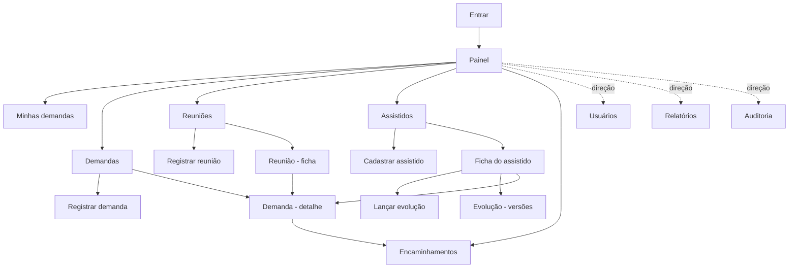

# Arquitetura da Informação

Frente de IHC. Cartão "Mapear a arquitetura da informação e o fluxo de navegação" (backlog no relatório v3, §3.2.4). Formato da **Aula 05** (Rosenfeld & Morville): tríade usuários, conteúdo e contexto; os quatro sistemas (organização, navegação, rotulação e busca); etapas diagnóstico → card sorting → sitemap → wireframe → tree testing.

Correção do relatório v3 (Quadro 12) aplicada: **o acesso é aberto**. Todo profissional ativo vê demandas, reuniões, assistidos, evoluções e encaminhamentos. O que muda por perfil são só as três funções da direção (usuários, relatórios e auditoria), que nem aparecem no menu dos outros perfis.

---

## 1. Diagnóstico: usuários, conteúdo e contexto

| Elemento da tríade | O que sabemos | Fonte |
| --- | --- | --- |
| **Usuários** | Direção, assistente social e equipe pedagógica; cerca de 6 ao mesmo tempo; profissionais com **baixa familiaridade com tecnologia**; a direção quer ver tudo "numa tela só" | `requisitos.md` §2.2, relatório v3 §3.2, `personas.md` |
| **Conteúdo** | Demandas (o centro), com histórico e anotações; reuniões de origem; assistidos (só nome de tratamento); evoluções; encaminhamentos; usuários; relatórios; auditoria | `contrato-api.md` §2, specs 01 a 09 |
| **Contexto** | Só dentro do CRIE, em computador, **internet instável**, computadores compartilhados; 3 reuniões semanais, uma por setor | `requisitos.md` §2.3, `arquitetura.md` §6 |

Consequências para a organização:
- A **demanda** é o objeto principal. Painel, lista, "minhas" e o detalhe giram em torno dela.
- As tarefas diárias (ver o que está atrasado, registrar, atualizar) ficam no primeiro nível do menu; as raras (relatório, auditoria, usuários) ficam no fim, só para a direção.
- Poucos itens de menu e rótulos curtos reduzem a **carga cognitiva** de quem usa pouco o computador.

---

## 2. Card sorting (simulado pela equipe)

**Atenção:** este card sorting foi **simulado pela equipe de desenvolvimento**, a partir das personas e dos cenários, como preparação. Não foi feito com profissionais do CRIE. Se houver oportunidade, repetir de forma **aberta** com dois ou três profissionais antes dos testes e registrar a diferença aqui.

**Cartões** (funções do sistema, na linguagem do CRIE):

| # | Cartão |
| --- | --- |
| 1 | Ver demandas atrasadas |
| 2 | Ver todas as demandas em aberto |
| 3 | Registrar uma demanda |
| 4 | Mudar a situação de uma demanda |
| 5 | Anotar o que foi feito numa demanda |
| 6 | Passar a demanda para outra pessoa |
| 7 | Ver o histórico de uma demanda |
| 8 | Procurar uma demanda antiga |
| 9 | Ver as demandas que estão comigo |
| 10 | Registrar uma reunião |
| 11 | Ver as demandas que saíram de uma reunião |
| 12 | Cadastrar um assistido |
| 13 | Ver tudo de um assistido |
| 14 | Lançar uma evolução |
| 15 | Corrigir uma evolução |
| 16 | Encaminhar para a rede (CRAS, CAPS, UBS...) |
| 17 | Ver encaminhamentos sem resposta |
| 18 | Registrar a resposta de um encaminhamento |
| 19 | Cadastrar um profissional no sistema |
| 20 | Tirar o acesso de quem saiu |
| 21 | Tirar relatório do mês |
| 22 | Ver quem consultou os dados de um assistido |

**Grupos formados** (fechado, com os nomes que viraram itens de menu):

| Grupo (rótulo do menu) | Cartões | Por quê |
| --- | --- | --- |
| **Painel** | 1, 2 | É a "tela só" da P1; é onde o dia começa |
| **Minhas demandas** | 9 | Atalho da P2 e da P3, que só cuidam do que é delas |
| **Demandas** | 3, 4, 5, 6, 7, 8 | Tudo que se faz *com* uma demanda acontece na lista e no detalhe dela |
| **Reuniões** | 10, 11 | A reunião é a origem; consultar o que saiu dela é a pergunta da semana seguinte |
| **Assistidos** | 12, 13, 14, 15 | Evolução é do assistido, não da demanda (QA02 em aberto); fica na ficha dele |
| **Encaminhamentos** | 16, 17, 18 | A lista de pendentes é uma pergunta própria ("quem a rede ainda não respondeu?") |
| **Usuários** (direção) | 19, 20 | Só a direção |
| **Relatórios** (direção) | 21 | Só a direção |
| **Auditoria** (direção) | 22 | Só a direção |

Cartões que poderiam cair em dois grupos e a decisão tomada:
- **16 Encaminhar** também é feito a partir da demanda (C4). Fica no grupo Encaminhamentos e aparece como ação **contextual** no detalhe da demanda e na ficha do assistido.
- **14 Lançar evolução** poderia ter item próprio no menu. Ficou dentro de Assistidos porque toda evolução precisa de um assistido: começar por ele evita um campo "qual assistido?" a mais.

---

## 3. Sitemap

```
Entrar
└── (depois do login)
    ├── Painel                          tela inicial de todos os perfis
    │   └── aviso de prazo (RF40)       só no primeiro acesso da sessão
    ├── Minhas demandas
    ├── Demandas
    │   ├── Registrar demanda
    │   └── Demanda (detalhe)
    │       ├── Mudar estado            diálogo com confirmação
    │       ├── Anotar
    │       ├── Trocar responsável      diálogo com confirmação
    │       └── Encaminhar              atalho para registrar encaminhamento
    ├── Reuniões
    │   ├── Registrar reunião
    │   └── Reunião (ficha)             demandas da reunião e estado de cada uma
    │       └── Editar reunião
    ├── Assistidos
    │   ├── Cadastrar assistido         só nome de tratamento
    │   └── Ficha do assistido          demandas, evoluções e encaminhamentos
    │       ├── Lançar evolução
    │       └── Evolução (versões)      retificar, sem apagar
    ├── Encaminhamentos                 abre nos pendentes
    │   └── Registrar desfecho          uma vez só
    ├── Usuários            [direção]   cadastrar, editar, desativar
    ├── Relatórios          [direção]   demandas do período; acompanhamento do assistido
    ├── Auditoria           [direção]
    └── Sair
```



Profundidade máxima: **três níveis** a partir do painel (Assistidos → Ficha → Evolução). Toda tarefa dos cenários C1 a C6 cabe nisso.

---

## 4. Os quatro sistemas

### 4.1 Organização

- **Por objeto** (demanda, reunião, assistido, encaminhamento), que é como a equipe já fala ("a demanda da reunião de terça", "a ficha do fulano").
- Dentro de demandas, **por estado**: as três situações em aberto viram as colunas do painel; concluída e cancelada saem do painel e continuam na lista e na busca.
- Listas em **ordem que responde à pergunta da tela**: painel e minhas demandas do prazo mais antigo (o atrasado primeiro); demandas pelo último movimento; reuniões pela data mais recente; assistidos em ordem alfabética.

### 4.2 Navegação

| Tipo | No sistema |
| --- | --- |
| **Global** | Menu lateral fixo no computador, sempre igual em todas as telas: Painel, Minhas demandas, Demandas, Reuniões, Assistidos, Encaminhamentos; para a direção, também Usuários, Relatórios e Auditoria. No celular vira menu recolhível com botão "Menu". Saudação com o nome e "Sair" sempre visíveis. |
| **Local** | Dentro de uma seção: filtros e busca da lista; ações do detalhe (Mudar estado, Anotar, Trocar responsável, Encaminhar); "Voltar para Demandas". |
| **Contextual** | Links dentro do conteúdo: da demanda para a reunião de origem e para o assistido; da ficha da reunião para cada demanda; do aviso de prazo para cada demanda. |
| **Suplementar** | Título da página igual ao item do menu marcado; título da aba do navegador com o nome da tela. Sem mapa do site: o menu já mostra tudo. |

Uma **ação principal por tela**, sempre como o botão mais forte: Painel → "Registrar demanda"; Reuniões → "Registrar reunião"; Assistidos → "Cadastrar assistido"; detalhe da demanda → "Mudar estado".

### 4.3 Rotulação

Regra: **a palavra do CRIE**, não a do sistema (RNF13). Rótulos consistentes do menu ao botão e à mensagem.

| Usamos | Evitamos | Motivo |
| --- | --- | --- |
| Entrar / Sair | Login / Logout | Português de uso comum |
| Registrar demanda | Nova demanda, Criar, Adicionar | "Registrar" é o verbo que a direção usa para reunião e demanda |
| Estado: Aberta, Em andamento, Aguardando terceiros, Concluída, Cancelada | Status, Pendente, Fechada | São os cinco valores do RF12 |
| Vencida | Atrasada, Expirada, Overdue | É a palavra do RF33 e da spec 02 |
| Perto do prazo | A vencer, Due soon | Spec 09 |
| Responsável | Atribuído a, Owner | Termo do RF10 |
| Assistido / Nome de tratamento | Paciente, Cliente, Usuário | Termo da instituição (`requisitos.md` §1.3) |
| Evolução / Retificar | Prontuário, Editar | Retificar deixa claro que a versão anterior fica |
| Encaminhamento / Desfecho | Ticket, Resposta | Termos do RF27 e do RF28 |
| Cancelar demanda | Excluir, Apagar | Nada é apagado (RNF19) |
| Setor: Pedagógico, Saúde, Serviço de convivência | Códigos internos | As três reuniões semanais |

Ícone nunca aparece sozinho: sempre com o texto ao lado (ou `aria-label`).

### 4.4 Busca

Na tela **Demandas**:

| Filtro | Tipo de campo | Observação |
| --- | --- | --- |
| Busca | texto livre "Procurar na descrição" | trecho da descrição, sem diferenciar maiúscula (RF32) |
| Estado | escolha múltipla | sem escolha, mostra as não canceladas |
| Responsável | lista de profissionais ativos | |
| Categoria | texto livre | não há lista fechada (A2 em aberto) |
| Período | duas datas, "de" e "até" | data de registro da demanda (A6 em aberto) |
| Assistido | lista por nome de tratamento | |

- Filtros ficam **recolhidos atrás de "Mais filtros"** no celular; a busca fica sempre à vista.
- Botão "Limpar filtros" sempre que algum filtro estiver ativo.
- Resultado vazio diz o que fazer: "Nenhuma demanda encontrada com esses filtros. Tente tirar um filtro ou procurar outra palavra."
- **Ordenação** fixa por último movimento, como no servidor. Ordenação por coluna não entra nesta versão (não está em requisito).

Busca também existe, mais simples, em **Assistidos** (trecho do nome).

---

## 5. Wireframe e tree testing

- **Wireframe:** a especificação tela a tela está em [`telas.md`](telas.md), para o protótipo no Figma (frente de IHC, decisão D2 em aberto) e para a implementação contarem a mesma história.
- **Tree testing:** proposta para antes dos testes de usabilidade, só com o sitemap em texto (sem tela). Perguntas, uma por cenário: "Onde você clicaria para ver as demandas atrasadas?" (Painel), "...para achar o pedido de material adaptado do mês passado?" (Demandas → busca), "...para lançar como foi a oficina do Assistido Fictício A?" (Assistidos → ficha), "...para saber quais encaminhamentos a rede ainda não respondeu?" (Encaminhamentos). Anotar o primeiro clique e se acertou. **Não executado.**

---

## 6. Justificativa pela carga cognitiva

- **Menu curto e estável:** seis itens para os profissionais, nove para a direção, na mesma ordem em todas as telas. A pessoa reconhece em vez de lembrar.
- **Tela inicial que já responde à pergunta do dia:** o painel abre com o que está vencido, sem precisar filtrar nada (persona P1, critério de aceitação 3).
- **Uma ação principal por tela** e ações secundárias agrupadas: menos decisão por tela.
- **Só as escolhas possíveis:** na mudança de estado aparecem só as transições válidas da spec 02; o profissional não precisa saber a regra.
- **Rótulos da instituição** e mensagens que dizem o que fazer (RNF13, RNF14): o modelo mental do usuário (como a equipe já trabalha no papel) se aproxima do modelo conceitual do sistema (Aula 03).
- **Nada se perde:** formulário preservado quando a internet cai (RNF16), o que reduz o medo de errar de quem usa pouco o computador.
