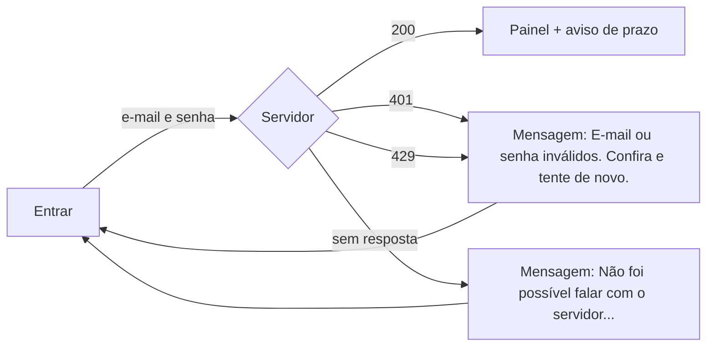
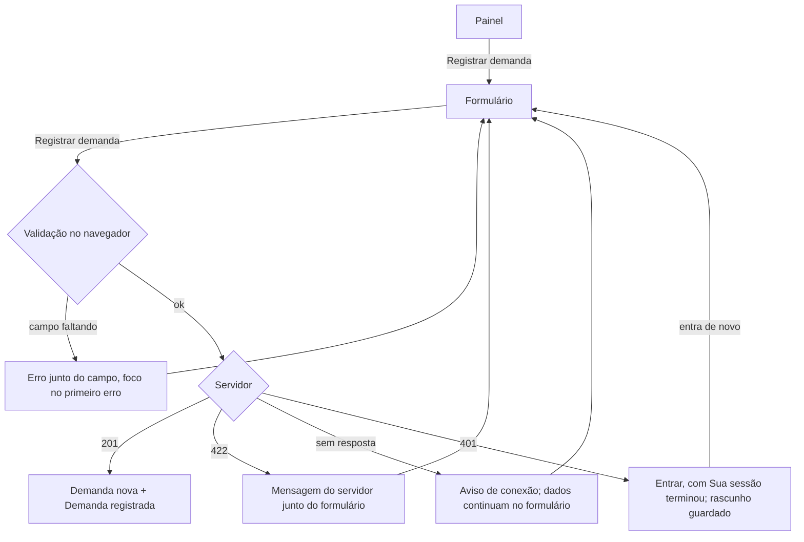

# Fluxos de navegação

Frente de IHC. Fluxos das tarefas principais, com a contagem de passos de cada um. A contagem é a **referência** para comparar com o número de passos medido nos testes de usabilidade (`plano-de-testes.md`): se o participante precisar de muito mais passos que o mínimo, há um problema de navegação.

**Como contamos um passo:** cada clique, escolha numa lista ou campo preenchido conta 1. Digitar dentro do mesmo campo conta 1. Rolar a página não conta.

Telas e rótulos conforme [`telas.md`](telas.md); estrutura conforme [`arquitetura-da-informacao.md`](arquitetura-da-informacao.md).

---

## Quadro-resumo

| Fluxo | Cenário | Passos mínimos | Telas percorridas |
| --- | --- | --- | --- |
| F1 Entrar | todos | 3 | Entrar → Painel |
| F2 Registrar demanda | C3 | 7 (4 campos + 3 cliques) | Painel → Registrar demanda → diálogo de confirmação → Demanda |
| F3 Mudar estado | C4, C5 | 4 | Demanda → diálogo → Demanda |
| F4 Anotar | C4 | 3 | Demanda |
| F5 Trocar responsável | C1 | 4 | Demanda → diálogo → Demanda |
| F6 Achar demanda antiga | C2 | 3 | Demandas → Demanda |
| F7 Do aviso de prazo à demanda | C5 | 1 | Painel → Demanda |
| F8 Lançar evolução | C6 | 7 | Assistidos → Ficha → Lançar evolução → Ficha |
| F9 Sair | todos | 1 | qualquer → Entrar |

---

## F1 — Entrar

1. Preencher e-mail.
2. Preencher senha.
3. Clicar em **Entrar**.

Resultado: Painel. Se houver demanda vencida ou perto do prazo, o aviso aparece no topo do painel (F7).

## F2 — Registrar demanda (RNF12: um formulário e uma confirmação)

1. No Painel, clicar em **Registrar demanda**.
2. Preencher **Descrição**.
3. Escolher **Prioridade**.
4. Escolher **Responsável**.
5. Preencher **Prazo**.
6. Clicar em **Registrar demanda**: abre o diálogo "Confirmar registro da demanda?" com o resumo do que foi preenchido.
7. Clicar em **Confirmar registro**.

A **reunião de origem** já vem preenchida com a reunião mais recente (é obrigatória na API, spec 02). Assistido e categoria são opcionais e não contam no mínimo. Depois de gravar, a página da demanda nova mostra "Demanda registrada com sucesso."

Interpretação do RNF12 adotada (a mesma da implementação): **um formulário** sem etapas e **uma confirmação**, o diálogo de revisão antes de gravar. Ele deixa a pessoa conferir os dados antes de criar o registro, que não pode ser apagado depois (RNF19). **Voltar** no diálogo devolve ao formulário sem perder nada.

## F3 — Mudar estado

1. No detalhe da demanda, clicar em **Mudar estado**.
2. Escolher o novo estado (só aparecem os possíveis).
3. Clicar em **Confirmar**.
4. Ver o histórico atualizado e a mensagem de sucesso.

Transições oferecidas (spec 02): Aberta → Em andamento ou Cancelada; Em andamento → Aguardando terceiros, Concluída ou Cancelada; Aguardando terceiros → Em andamento ou Cancelada. Concluída e Cancelada não mostram o botão.

Observação para o teste da tarefa T5: concluir uma demanda **Aberta** exige passar por Em andamento, então são dois ciclos de F3 (8 passos). É regra do servidor; se os testes mostrarem confusão, registrar no relatório de usabilidade como problema e levar à equipe (não contornar no cliente).

## F4 — Anotar

1. No detalhe, clicar no campo **Anotar**.
2. Escrever o texto.
3. Clicar em **Salvar anotação**.

## F5 — Trocar responsável

1. No detalhe, clicar em **Trocar responsável**.
2. Escolher a pessoa.
3. Clicar em **Confirmar**.
4. Ver a troca anotada no histórico.

## F6 — Achar uma demanda antiga

1. No menu, clicar em **Demandas**.
2. Escrever um trecho da descrição em **Procurar na descrição**.
3. Clicar na demanda encontrada.

Meta do critério de aceitação 2 (`requisitos.md` §8): achar e consultar o histórico **em menos de um minuto**.

## F7 — Do aviso de prazo à demanda

1. No aviso do Painel, clicar no link da demanda.

## F8 — Lançar evolução

1. No menu, clicar em **Assistidos**.
2. Escrever o nome de tratamento na busca.
3. Clicar no assistido.
4. Clicar em **Lançar evolução**.
5. Preencher **Data** (já vem com hoje), **Área de atuação** e **Descrição**: conta 2 (área e descrição).
6. Clicar em **Salvar evolução**.

## F9 — Sair

1. Clicar em **Sair** (sempre visível no menu). O token é revogado no servidor e apagado do navegador.

---

## Fluxos de exceção comuns a todas as telas

| Situação | O que a pessoa vê | O que acontece com o que estava preenchido |
| --- | --- | --- |
| Internet caiu (sem resposta) | "Não foi possível falar com o servidor. Seus dados continuam no formulário. Tente de novo." | Fica no formulário |
| Sessão terminou (401: 30 minutos, Sair em outra aba, conta desativada) | Tela Entrar com "Sua sessão terminou. Entre de novo." | Guardado como rascunho e devolvido ao voltar para a mesma tela |
| Sem permissão (403) | A mensagem do servidor, em português, e um link para voltar ao Painel | Nada a preservar |
| Não encontrado (404) | "Esta demanda não existe ou o endereço está errado." e link para Demandas | — |
| Regra recusada (400) | A mensagem do servidor (por exemplo "Esta demanda não pode mudar para esse estado.") | Fica no diálogo |
